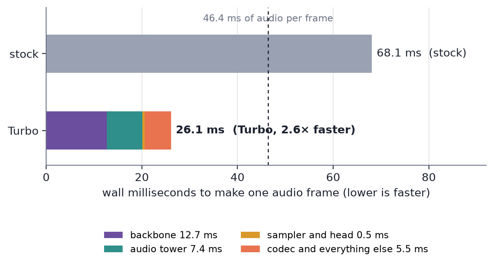
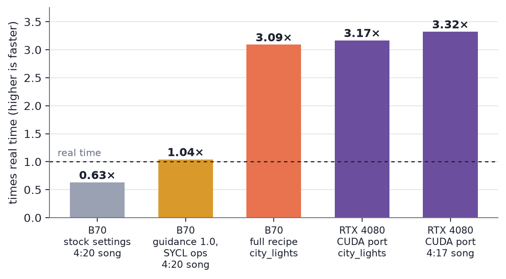

# Making YuE2 and Drama 3 fast on one graphics card

Omnispace Technologies and the myradio contributors  
2026-11-07

## Abstract

myradio is an open-source radio station that runs at home on a single graphics card: a music model writes and sings the songs and a speech model voices the DJ. Neither model was fast enough on one consumer card when this work began. On an Intel Arc Pro B70 (32 GB), stock YuE2 3B made a 4:20 song in 6:54, 0.63× real time, and stock Drama 3 needed 68.1 ms to make each 46.4 ms frame of speech.

Over several days of quantization, kernel and serving work on that one card, we made Drama 3 2.6× faster (26.1 ms per frame, a real-time factor of 0.56, first streamed audio in 0.30 to 0.34 s) while cutting failed takes from 12 of 84 to 1 of 84. We took YuE2 from 0.63× to 3.09× real time at 8 diffusion steps, with first streamed audio in 7.58 to 7.73 s and a 30-minute real-paced queue with zero underruns. The YuE2 work then carried over to CUDA, where an RTX 4080 runs at 3.17× to 3.32×. Both builds are published with their receipts [1, 3]. Before release, three hour-long stations on a Mac mini, an RTX 4080 and a DGX Spark checked that the result works on air.

## 1 Introduction

A radio station that makes its own songs has a simple speed requirement: songs must be made faster than they play, and the DJ must speak without stalling, on the same machine and ideally on the same card. YuE2 3B from Multimodal Art Projection can write and sing a whole song from lyrics [4], and Drama 3 from Fish Audio is an expressive speech model that takes direction on tone [5]. Both run through audio.cpp [2]. On one Intel Arc Pro B70, out of the box, neither met the requirement.

This paper reports the work that changed that: what was slow, what we changed, and what each change bought, with the measurements published on the model cards [1, 3]. Section 3 covers Drama 3, section 4 covers YuE2 on the B70 and its port to CUDA, and section 5 reports the pre-release check: three stations run for an hour each on the finished builds.

## 2 Hardware and software

The research card is an **Intel Arc Pro B70** with 32 GB of memory on the xe driver, in a box with an AMD Ryzen 9 5950X, using oneAPI 2026.1 and SYCL through Level Zero. The starting runtime is audio.cpp at JarodMica's `drama-3-native` branch, commit `4dbb4d1` [2]. The models are YuE2 3B as Q8_0 GGUF with an F16 VAE from audio-cpp/Yue2-3B-GGUF, and Drama 3 converted from Fish Audio's release. The CUDA port ran on an NVIDIA RTX 4080 (16 GB, CUDA 13.0, SM 8.9) with clocks and power limits unchanged.

Speed is reported as audio seconds divided by wall seconds (times real time, higher is faster) for music, and as wall milliseconds per audio frame or the real-time factor (wall over audio, lower is faster) for speech, matching how each model card reports it.

## 3 Drama 3 B70 Turbo

### 3.1 Where the time went

Stock audio.cpp on the B70 needed **68.1 ms** to make each **46.4 ms** frame of Drama 3 speech: an offline real-time factor of 1.47, slower than real time. Profiling showed the Fish DAC codec decoding on the CPU, taking 36 of every 66 ms per frame. Quality was a problem too: on held-out seeds, 4 of 28 takes were catastrophic (content error above 0.5) and 3 of 28 never ended.

### 3.2 What changed

1. **The codec runs on the GPU.** A windowed `CONV_TRANSPOSE_1D` SYCL kernel and a SYCL depthwise convolution moved codec decoding onto the card.
2. **The sampler matches upstream.** The port capped the main semantic token at top-k 30; upstream Drama 3 does not, and keeps the token that crosses top-p. That cap caused most of the takes that went silent and never stopped. Fixing it was the single biggest quality win: on the tuning seeds, catastrophic takes went from 8 of 56 to 0 (paired exact test, p = 0.008).
3. **SYCL graphs are cached.** Each decode graph is recorded once and replayed. Output codes stay bit-identical and decode drops from 23.6 to 22.2 ms per frame. A sliced lm_head, asynchronous uploads and a small-row top-k router kernel add smaller decode wins.
4. **Quantization.** The final file keeps the mixture-of-experts layers at Q4_K, the backbone at Q8_0 and the audio tower's matmuls at Q8_0, with the router, shared expert, lm_head, tower embeddings and heads, norms and codec left at F16/F32. Moving the tower's matmuls to Q8_0 made the file 0.9 GB smaller and decode 1.6 ms faster with no measurable content loss. Q6 experts were slower with no gain; Q5 experts tied the default within noise; offloading expert layers to the CPU was ruled out.

### 3.3 Results

**Table 1. Drama 3 on one Arc Pro B70, stock against Turbo.** Stock is audio.cpp's SYCL path with only the B70 backend patch. Content error is Whisper large-v3 WER (CER for Chinese and Japanese) on held-out seeds never used for tuning.

| | Stock | Turbo |
| --- | ---: | ---: |
| Wall ms per audio frame (long take, warm) | 68.1 | **26.1** |
| Offline real-time factor (lower is faster) | 1.47 | **0.56** |
| Streaming time to first audio | n/a | **0.30–0.34 s** |
| Streaming real-time factor | n/a | **0.66–0.78** |
| Held-out content error (28 takes) | 0.134 | **0.042** |
| Held-out catastrophic takes | 4 / 28 | **1 / 28** |
| Held-out takes that never end | 3 / 28 | **1 / 28** |
| File size | 25.2 GB | **24.3 GB** |



*Figure 1. Wall time to make one 46.4 ms frame of speech on the B70. Turbo's 26.1 ms splits into backbone 12.7 ms, audio tower 7.4 ms, sampler and head 0.5 ms, and codec and everything else 5.5 ms.*

A fresh-boot re-run through the same harness, three repeats each, measured stock at 68.0–68.8 ms and Turbo at 26.2–26.5 ms per frame: **2.62×**. On a 21 s, four-sentence reply, stock ran at a real-time factor of 1.53 and Turbo at 0.62. A separate multilingual run made 267 s of audio in 148 s across 37 takes in six languages. Across all 84 scored takes, stock had 12 catastrophic takes and Turbo had 1.

Streaming is what makes it usable as a live voice. Five texts, from a six-word acknowledgement to a 26 s story, at three seeds each, streamed over HTTP against a real-time player: first audio arrived in **0.27 to 0.35 s**, and there were **zero playback gaps in 161 s of audio** with no client pre-buffer. Each new sentence costs about 1 s of prefill, which the audio already queued covers.

Isolated kernel benchmarks on the same card measured the windowed `CONV_TRANSPOSE_1D` kernel at up to **710×** on codec shapes and a short-row `TOP_K` kernel at up to **18.5×**, with conv and top-k correctness suites passing. These are isolated kernels, not additional end-to-end results; the end-to-end figure is the 2.62× above.

**How it was measured.** Fourteen texts (English, dialogue, tags, numbers, Chinese, Japanese) were generated at several seeds and transcribed by Whisper large-v3. Every configuration was ranked on 4 tuning seeds (56 takes) and the winner was checked on 2 held-out seeds (28 takes). Takes are paired by text and seed; bootstrap intervals are clustered by text, and catastrophic takes get an exact McNemar test. Speed was measured on a quiet, warm box with per-stage timers, re-run after a reboot with a spread under 1.2%. A fresh clone with the patches builds cleanly and produces bit-identical output codes. Whisper scores content, not naturalness or voice similarity.

## 4 YuE2 Turbo Radio

### 4.1 From 0.63× to real time

YuE2 did not run on the B70 at first: audio.cpp's SYCL backend lacked three operations the model needs. We added them: `ROUND_BF16` (a new SYCL kernel matching ggml's round-to-nearest-even and quiet-NaN rule), `EXPM1` (ported from upstream llama.cpp's ggml-sycl, used by SELU in the non-autoregressive stage) and `concat` for F16/BF16. The unsupported-op error now names the missing operation, which is how the first two were found.

The second change was one setting. The default `guidance_scale` of 1.01 runs classifier-free guidance, two sequences per token. At exactly 1.0 YuE2 takes its single-sequence path, which made the semantic stage about **2.2× faster**. A 4:20 song that took **6:54 (0.63×)** on stock settings rendered in **4:09 (1.04×)**, and songs up to about 4:45 now rendered faster than they played.

**Table 2. Real-time sweep on the B70, 2026-10-29.** YuE2 3B Q8_0, F16 VAE, `cot=off`, 8 diffusion steps, one render at a time. Stage times are the semantic (autoregressive) stage, the non-autoregressive (NAR) stage and the VAE.

| Song length | Render time | × real time | Semantic | NAR | VAE |
| --- | ---: | ---: | ---: | ---: | ---: |
| 1:36 | 56 s | 1.71 | 34 s | 18 s | 3 s |
| 2:30 | 108 s | 1.39 | 65 s | 37 s | 5 s |
| 3:20 | 169 s | 1.19 | 99 s | 62 s | 7 s |
| 4:20 | 249 s | 1.04 | 140 s | 100 s | 9 s |
| 4:50 | 295 s | 0.98 | 162 s | 122 s | 10 s |
| 5:10 | 327 s | 0.95 | 178 s | 138 s | 10 s |
| 4:20, stock guidance 1.01 | 414 s | 0.63 | 306 s | 98 s | 9 s |

The sweep showed the next bottleneck: the NAR stage grew faster than song length because it ran as one chunk over the whole song.

### 4.2 From real time to 3×

The next round of work on the B70 targeted the stages the sweep exposed: growing autoregressive buffers instead of reallocating them, cached NAR prefixes, bounded NAR windows (1,024 frames with a 128-frame overlap) so the NAR stage no longer grows with the whole song, deferred packed-weight uploads, and Intel-specific kernels. On 2026-11-01 the B70 build measured **3.091× session real time** on city_lights at 8 steps, **2.414×** at 32 steps and **2.141×** on a long track at 32 steps. Streaming 279.6 s songs, first audio arrived in **7.58 to 7.73 s** with zero late chunks in 3 of 3 runs, and a real-paced 30-minute queue of 13 songs passed with zero underruns, no inserted silence and a matching PCM hash. That build then ran a live station.

### 4.3 Porting to CUDA

The same changes carried over to an RTX 4080: growing buffers, cached NAR prefixes, bounded NAR windows and deferred packed-weight uploads, with CUDA Flash Attention and CUDA graphs replacing the Intel-specific kernels. An opt-in streaming pipeline overlaps NAR weight loading with earlier work and keeps the output byte-identical to its predecessor.

**Table 3. YuE2 on the RTX 4080.** One warm-up discarded, then three separate cold CLI processes per configuration. Session speed excludes CLI start-up; the last column includes it.

| Workload | Steps | Audio | Session speed | Including start-up |
| --- | ---: | ---: | ---: | ---: |
| city_lights | 8 | 69.00 s | **3.168×** | 3.019× |
| city_lights | 32 | 69.00 s | **2.754×** | 2.648× |
| Four-minute song | 8 | 257.08 s | **3.322×** | 3.269× |

The 4:17 song takes about 79 s including start-up. Streaming first audio, including cold start-up, arrived in **8.56 to 9.43 s** with zero late chunks and zero gaps in 3 of 3 runs, and a 30-minute real-paced playlist (86.4 million stereo frames) passed with zero queue failures and a matching PCM hash.



*Figure 2. YuE2 speed from stock settings on the B70 to the CUDA port. The first two bars are the 4:20 sweep song; the rest are the city_lights benchmark at 8 steps and the 4:17 long song.*

## 5 Release check: an hour on air

The builds above are what myradio 0.4.0 ships. Before release we checked that they hold up inside the full application: three stations, set up from scratch, each run for an hour with an agent programming it. These runs test the product, not the models; their speeds include the station's own scheduling and are not research results.

### 5.1 Setup

The music engine is the YuE2 Turbo Radio build on audio.cpp [1, 2]. The hour runs use YuE2-3B Q8_0 weights and an F16 variational autoencoder (VAE), which decodes the generated audio representation. Music workers submit generation jobs and retain timings in job provenance. The station keeps generated tracks in its library and schedules them for playback.

The Mac uses the command-line Metal worker. The RTX desktop uses the full-song CUDA build. The Spark uses a dual loader: one audio.cpp server keeps YuE2 and Drama 3 B70 Turbo resident together [3]. The `yue2_http` music worker and the Drama speech worker have separate resource groups. A song and a speech clip can therefore render concurrently. The measured joint resident memory was 24 GB.

The agent DJ connects through `python3 -m myradio.mcp`. It requests songs, writes spoken lines and places items in the queue. In the Spark run, the agent wrote lead-ins, links and station IDs for Wren, a fictional host cloned from a reference take. It aimed for a break every two or three songs and an ID about every 15 minutes. The studio provides separate music and speech crates and controls for queue changes.

### 5.2 Method

**Table 4. Hardware and application builds for the station runs.** Memory refers to system memory on the Mac and Spark, and GPU memory on the RTX desktop.

| Machine | Processor and memory | Platform / backend | myradio commit |
| --- | --- | --- | --- |
| Mac mini | Apple M4 Pro, 24 GB | macOS 26.6.2 / Metal | `469a025` |
| apollo | NVIDIA RTX 4080, 16 GB | Ubuntu 24.04.4 / CUDA | `9035b5c` |
| toymaker | DGX Spark, NVIDIA GB10, 121 GB unified | CUDA 13.0, built for `sm_121` | `42f1364` |

Each station was set up from scratch. The Mac played pop punk and hard rock. The RTX and Spark stations played lofi songs about fine-tuning models. The Mac and RTX setups each began with 12 original song descriptions containing tags and lyrics. They requested about 2:45 per song. The Spark receipt does not record a requested song length; its completed songs span 114.67–165.00 s. Music rendered one job at a time on each machine. On the Spark, speech could run beside that music job.

Music used eight steps, guidance 1.0 and `cot=full`, with the accepted build settings recorded in the receipts. The Mac command used eight threads. The RTX agent requested another song when fewer than three fresh songs were waiting. These runs include the station's actual programming and queue decisions.

A **render** is a completed generation job, counted once whether or not its output aired. A **song play** or **DJ clip play** is an observed `now_playing` event. Repeat plays count again. Render totals use the complete `renders.json` files. Failure counts and the observation interval come from `hour-run-report.json`. The logs contain 238, 237 and 237 status checks for the Mac, RTX and Spark, respectively.

The **realtime factor** used here is audio seconds divided by render wall seconds. A value above 1.0× means generation is faster than playback. Overall speed divides summed audio duration by summed render time. Per-song medians summarize individual ratios. Render time is distinct from the elapsed station interval and from time spent waiting in a queue.

Timeline zero is the log's `on_air` marker for Start. Queue depth counts entries in each status check's `queue`, including repeated fills and speech. Airplay curves count observed starts. For request-to-airing time, we match a `dj_request` to the first later `now_playing` event with the exact same title and take suffix. Unmatched requests are excluded. This interval includes generation and programming waits.

The Spark's separate dual-loader benchmark contains one music take per condition, three speech takes alone and four speech takes beside music, including a repeated line. Speech speed is pooled across durations. The DJ voice bake-off used the same hype text and song lead-in while YuE2 rendered. Its reported speed is the successful lead-in take with the voice already loaded. Model sizes and licence categories follow [the voice notes](data/dj-voices.md). Raw task-configuration errors are kept in the evidence; successful retries supply the plotted points.

### 5.3 Results

**Table 5. Published hour-run results.** Music speed excludes speech renders. The Spark's 40 renders comprise 26 music renders and 14 speech renders. Each run had zero failed renders.

| Machine | On air (s) | Music renders | Song plays | DJ clip plays | Music made (min) | Music render time (min) | Overall speed | Median song speed |
| --- | --- | --- | --- | --- | --- | --- | --- | --- |
| Mac mini | 3,604 | 26 | 25 | 0 | 60.6 | 58.8 | 1.03× | 1.04× |
| RTX 4080 | 3,611 | 28 | 25 | 0 | 68.9 | 19.0 | 3.64× | 3.64× |
| DGX Spark | 3,610 | 26 | 24 | 12 | 61.8 | 27.0 | 2.29× | 2.35× |

The raw timing sums reproduce the receipt summaries at their published precision. Every logged status check has `running=true`, and each report ends in the playing state. The receipts report no stops. The Mac and Spark logs each contain an initial waiting check; subsequent checks show playback. [NUMBERS.md](NUMBERS.md) records that distinction and all rounding reconciliations.


*Figure 3. Each point is a completed song render. Vertical marks show the published medians. The dashed line marks playback speed. Mac song speeds occur on both sides of that line; its overall speed was 1.03×.*


*Figure 4. Cumulative observed song starts and queue depth over each run. The dashed Spark curve counts DJ clip starts. Queue depth includes repeated entries and is distinct from a buffer of fresh songs. Times are status-log observations.*


*Figure 5. Render wall time versus actual song length. Lines are separate least-squares fits over each run's observed lengths. They describe the measured takes; the Spark points include its shared-GPU workload.*


*Figure 6. Music duration produced, summed music render time and the published on-air interval. Generated music includes completed takes that had not aired when the observation ended.*

The Spark generated 11 DJ breaks and three station IDs: 2.8 min of speech in 3.7 min of rendering. Its 24 song plays covered 23 distinct titles. The receipt records three speech clips requeued from the studio and aired again. These repeat plays are included in the 12 observed DJ clip plays.


*Figure 7. In the separate Spark benchmark, music ran at 2.34× alone and stayed above playback speed at 1.72× with the DJ voice rendering beside it. Pooled speech speed was 1.50× alone and 0.62× beside music. These are the receipt's rounded ratios from the raw duration sums.*


*Figure 8. Successful warmed lead-in speed beside music versus reported model size on the Spark. Both axes are logarithmic. Colours follow the licence categories. “Conditional” groups the Fish Audio Community License and bilibili Model Use License; their terms are distinct.*

**Table 6. Local DJ voice measurements and recorded listener preferences.** Speed means the lead-in take beside music. Licence names follow the voice notes.

| Voice | Size (GB) | Speed | Licence | Recorded preference |
| --- | --- | --- | --- | --- |
| Chatterbox Turbo | 0.7 | 1.72× | MIT | — |
| Chatterbox | 2.1 | 1.42× | MIT | Also liked |
| VoxCPM2 | 3.0 | 1.03× | Apache-2.0 | — |
| Kokoro 82M | 0.2 | 11.20× | Apache-2.0 | — |
| Qwen3-TTS CustomVoice | 2.8 | 0.63× | Apache-2.0 | First local pick |
| Qwen3-TTS VoiceDesign | 2.8 | 0.62× | Apache-2.0 | — |
| VibeVoice 1.5B | 3.2 | 0.50× | MIT | — |
| Drama 3 B70 Turbo | 22.7 | 0.36× | Fish Audio Community License | Second pick, prompt style C |
| Maya1 | 4.0 | 0.24× | Apache-2.0 | — |
| IndexTTS2 | 3.6 | 0.23× | bilibili Model Use License | Third local pick |

The listener's preferred local voice was Qwen3-TTS CustomVoice, followed by Drama 3 with tone tags through the line, then IndexTTS2. These preferences are listening notes, not quality scores. Kokoro had the highest measured lead-in speed. The table keeps voice choice separate from speed ranking.


*Figure 9. Recorded song requests matched to their first later observed airing. Median intervals were 362.7 s for the Mac (22 matches), 137.0 s for RTX (23) and 308.8 s for Spark (20). Points include queue waits. The RTX receipt separately records its first song on air 56 s after the initial request; that request precedes the hour log.*

### 5.4 What the hour runs showed

The Mac run sustained the station with music generation close to playback speed. The RTX run produced more music per render minute and used an explicit limit on fresh songs waiting. The Spark run combined music and spoken hosting in one server. Its hour-wide music speed includes periods with and without active speech generation. The concurrent benchmark measures the interval when the workloads run together.

Scheduling affected the show as well as generation speed. The Spark receipt records two deferred breaks: the requested priority interacted with a speech buffer that holds back new work when two unused clips are ready. The agent intervened with urgent requests. The receipt describes a harness change to use urgent priority, keep a general link ready and place a song after its lead-in is ready. A temporary voice audition also used about 47 s of GPU time during the run. The published hour followed a clean restart after an earlier harness error.

The request-to-airing distribution reflects programming choices. A rendered track can wait while other material airs. Faster rendering and a shorter request-to-airing interval therefore measure different parts of the station. These logs establish observed airplay and job timings; their status checks do not provide sample-accurate transition boundaries.

The voice results add another practical choice. Speed, model size, licence and the listener's preferred performance all matter. myradio's app licence is Apache-2.0. The models retain their own licences. YuE2 songs are CC BY-NC, and Drama 3 is under the Fish Audio Community License.


## 6 Open questions and how to help


[RESEARCH.md](data/RESEARCH.md) asks for work on serving speed across hardware, fast first audio and dynamic workloads. It also calls for repeatable quality checks for lyric adherence, vocal clarity, returning choruses, clipping, endings and loudness. Existing station checks cover silence, clipping and cut-off endings.

Further directions include extracting model structure and tuning from semantic tokens, and using small models to control synthesizers or vocal processing through a knob, pad, voice or gesture. Head control is a planned research direction.

Contributors can reproduce a timing on another machine, run a station for an hour, measure a speed change on the same hardware or build a quality check and compare it with listeners. Controllers can use `myradio/extensions.py` or the station operations exposed to agents. A useful receipt records the hardware, exact build and command, audio duration and wall time, and retains the audio for listening.


## 7 Reproducing

Both model cards carry the full recipes, patches, pinned sources and receipts: [Drama 3 B70 Turbo](https://huggingface.co/Frosty40/Drama-3-B70-Turbo-GGUF) and [YuE2 Turbo Radio](https://huggingface.co/Frosty40/YuE2-Turbo-Radio), including the B70 recipe in its history. Figures 1 and 2 are rebuilt from the card numbers with:

```bash
uv run --with matplotlib python make_quant_figures.py
```


The `data/mac-mini/`, `data/apollo/` and `data/toymaker/` directories each contain a summary report, a JSONL timeline and complete per-render timings. The matching dated Markdown receipts supply published numbers. `data/toymaker/bench-dual.json` contains the concurrency experiment. `data/voices/*.json` and `data/dj-voices.md` contain voice trials and their interpretation. Product facts and research directions are in the remaining Markdown files.

Rebuild the figures and numerical ledger from this directory:

```bash
./venv/bin/python make_figures.py
```

The script reads every data file, checks hour summaries against receipts, and writes PNG figures at 200 dpi and matching SVGs. It also refreshes [NUMBERS.md](NUMBERS.md), which gives source fields or lines for every reported quantity, individual plot inputs, matching rules and fit coefficients. It uses local matplotlib and numpy and makes no network requests.

For a new station run, use the build, backend and accepted model settings in the relevant receipt, connect an agent with `python3 -m myradio.mcp`, and retain the generation provenance and status log. The Mac receipt records the music command:

```bash
audiocpp_cli --task gen --family yue2 --backend metal --threads 8
```

The receipts provide the additional model settings and build identifiers. This analysis regenerates the published figures from the evidence; a new run produces a new receipt.


## Acknowledgements

We thank Multimodal Art Projection for YuE2; Fish Audio for Drama 3; ShugoAI and the audio.cpp contributors; the ggml and llama.cpp authors, whose SYCL work the EXPM1 and concat kernels derive from; and the Qwen3-TTS contributors. Omnispace Technologies is a member of the NVIDIA Inception program. We also thank the myradio contributors and listeners who supplied the runs and voice preferences.

## References

1. **YuE2 Turbo Radio.** [Model card, build and receipts](https://huggingface.co/Frosty40/YuE2-Turbo-Radio); the B70 recipe and October sweep are in its history.
2. **audio.cpp.** [JarodMica/audio.cpp](https://github.com/JarodMica/audio.cpp), `drama-3-native` branch at `4dbb4d1`.
3. **Drama 3 B70 Turbo.** [Model card, patches and receipts](https://huggingface.co/Frosty40/Drama-3-B70-Turbo-GGUF).
4. **YuE2 3B.** [m-a-p/YuE2-3B](https://huggingface.co/m-a-p/YuE2-3B), Multimodal Art Projection; GGUF by [audio-cpp/Yue2-3B-GGUF](https://huggingface.co/audio-cpp/Yue2-3B-GGUF).
5. **Drama 3.** [fishaudio/drama-3](https://huggingface.co/fishaudio/drama-3), Fish Audio.
6. **Qwen3-TTS CustomVoice and VoiceDesign.** Models named in [the DJ voice notes](data/dj-voices.md).
7. **Chatterbox, Chatterbox Turbo, VoxCPM2, Kokoro 82M, VibeVoice 1.5B, Maya1 and IndexTTS2.** Additional models named and measured in [the DJ voice notes](data/dj-voices.md) and `data/voices/`.
