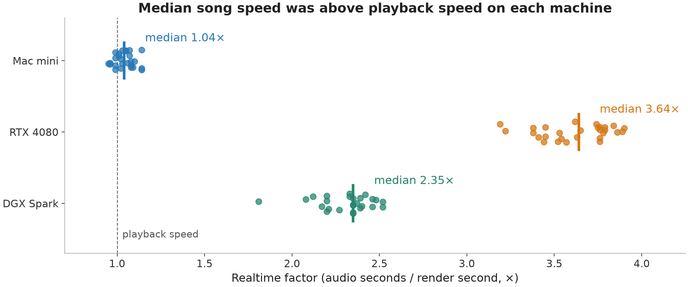
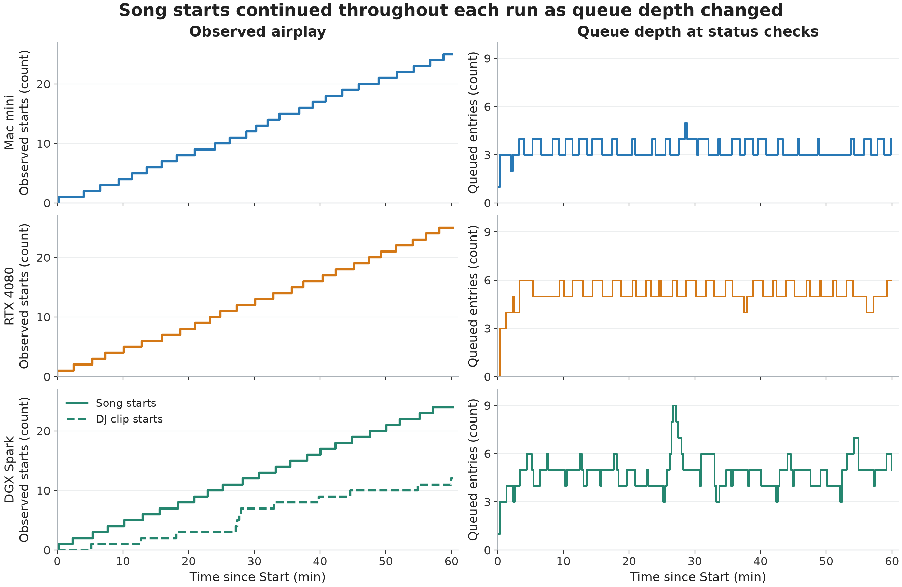
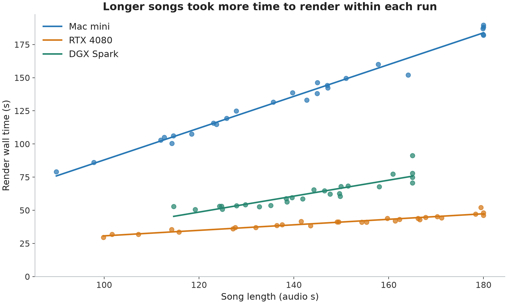
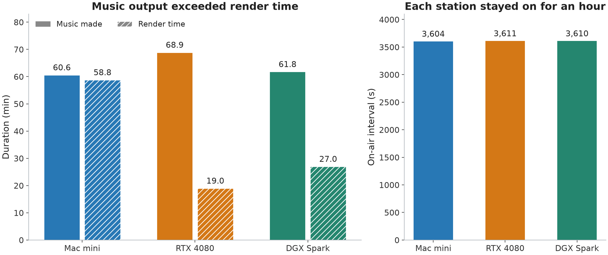
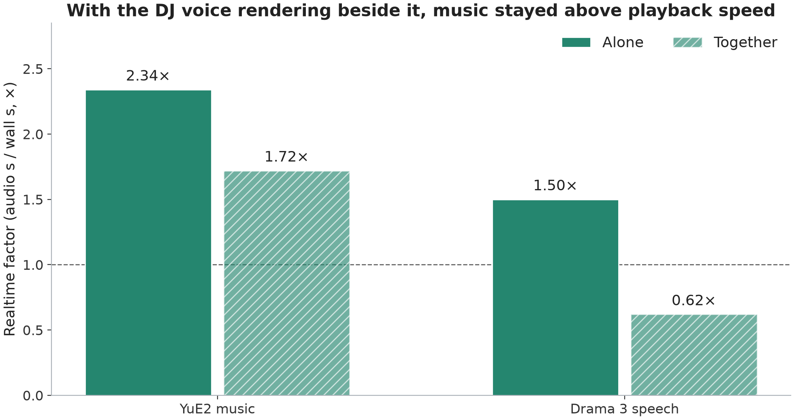
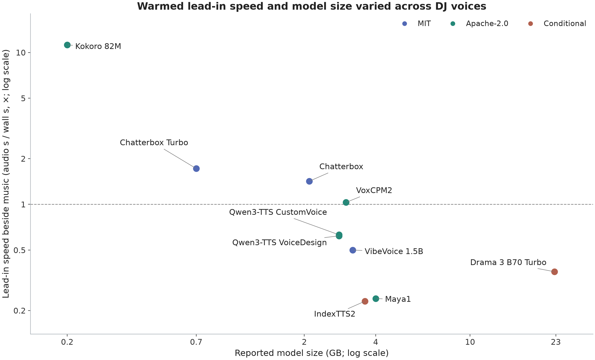
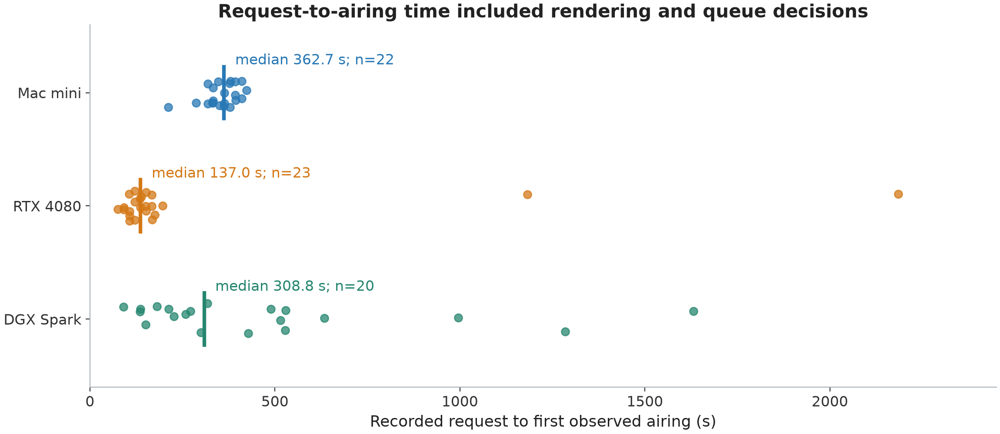

# myradio: Hour-long benchmarks of a local AI radio station

Omnispace Technologies and the myradio contributors  
2026-11-06

## Abstract

myradio is an open-source app that runs a live AI radio station on a user's computer. YuE2 Turbo Radio generates songs with lyrics through audio.cpp. A connected agent programs the station through the Model Context Protocol (MCP). Drama 3 supplies the DJ voice in the combined music and speech run. We report three hour-long station runs on a Mac mini, an RTX 4080 desktop and a DGX Spark. Their overall realtime factors—audio duration divided by render wall time—were 1.03×, 3.64× and 2.29× for music. The stations aired 25, 25 and 24 song plays, respectively. The Spark also aired 12 DJ clips while music and speech shared a server. Each receipt reports no stops and zero failed renders. A separate concurrency benchmark and a DJ voice bake-off show how speech generation fits beside music.

## 1 Introduction

A personal radio station can make songs about what is happening around its listeners. In one real example, an agent watched a live Dota stream through screenshots and requested songs about the play as it happened. The same station tools can turn study notes, chat or family dedications into music. The agent supplies that context and writes the DJ copy. myradio generates, queues and plays the audio.

This paper measures the station while it is on air. The evidence combines render timings with status checks and programming actions. This connects model speed to the practical task of keeping a station supplied with new material. All measurements come from the run data published with this paper. Published summaries follow the matching [Mac](data/2026-11-06-mac-mini-hour.md), [RTX](data/2026-11-06-apollo-hour.md) and [Spark](data/2026-11-06-toymaker-dual-loader-hour.md) receipts.

## 2 System

The music engine is the YuE2 Turbo Radio build on audio.cpp [1, 2]. The hour runs use YuE2-3B Q8_0 weights and an F16 variational autoencoder (VAE), which decodes the generated audio representation. Music workers submit generation jobs and retain timings in job provenance. The station keeps generated tracks in its library and schedules them for playback.

The Mac uses the command-line Metal worker. The RTX desktop uses the full-song CUDA build. The Spark uses a dual loader: one audio.cpp server keeps YuE2 and Drama 3 B70 Turbo resident together [3]. The `yue2_http` music worker and the Drama speech worker have separate resource groups. A song and a speech clip can therefore render concurrently. The measured joint resident memory was 24 GB.

The agent DJ connects through `python3 -m myradio.mcp`. It requests songs, writes spoken lines and places items in the queue. In the Spark run, the agent wrote lead-ins, links and station IDs for Wren, a fictional host cloned from a reference take. It aimed for a break every two or three songs and an ID about every 15 minutes. The studio provides separate music and speech crates and controls for queue changes.

## 3 Method

**Table 1. Hardware and application builds for the station runs.** Memory refers to system memory on the Mac and Spark, and GPU memory on the RTX desktop.

| Machine | Processor and memory | Platform / backend | myradio commit |
| --- | --- | --- | --- |
| Mac mini | Apple M4 Pro, 24 GB | macOS 26.6.2 / Metal | `469a025` |
| apollo | NVIDIA RTX 4080, 16 GB | Ubuntu 24.04.4 / CUDA | `9035b5c` |
| toymaker | DGX Spark, NVIDIA GB10, 121 GB unified | CUDA 13.0, built for `sm_121` | `42f1364` |

Each station was set up from scratch. The Mac played pop punk and hard rock. The RTX and Spark stations played lofi songs about fine-tuning models. The Mac and RTX setups each began with 12 original song descriptions containing tags and lyrics. They requested about 2:45 per song. The Spark receipt does not record a requested song length; its completed songs span 114.67–165.00 s. Music rendered one job at a time on each machine. On the Spark, speech could run beside that music job.

Music used eight steps, guidance 1.0 and `cot=full`, with the accepted build settings recorded in the receipts. The Mac command used eight threads. The RTX agent requested another song when fewer than three fresh songs were waiting. These runs include the station's actual programming and queue decisions.

A **render** is a completed generation job, counted once whether or not its output aired. A **song play** or **DJ clip play** is an observed `now_playing` event. Repeat plays count again. Render totals use the complete `renders.json` files. Failure counts and the observation interval come from `hour-run-report.json`. The logs contain 238, 237 and 237 status checks for the Mac, RTX and Spark, respectively.

The **realtime factor** used here is audio seconds divided by render wall seconds. A value above 1.0× means generation is faster than playback. Overall speed divides summed audio duration by summed render time. Per-song medians summarize individual ratios. Render time is distinct from the elapsed station interval and from time spent waiting in a queue.

Timeline zero is the log's `on_air` marker for Start. Queue depth counts entries in each status check's `queue`, including repeated fills and speech. Airplay curves count observed starts. For request-to-airing time, we match a `dj_request` to the first later `now_playing` event with the exact same title and take suffix. Unmatched requests are excluded. This interval includes generation and programming waits.

The Spark's separate dual-loader benchmark contains one music take per condition, three speech takes alone and four speech takes beside music, including a repeated line. Speech speed is pooled across durations. The DJ voice bake-off used the same hype text and song lead-in while YuE2 rendered. Its reported speed is the successful lead-in take with the voice already loaded. Model sizes and licence categories follow [the voice notes](data/dj-voices.md). Raw task-configuration errors are kept in the evidence; successful retries supply the plotted points.

## 4 Results

**Table 2. Published hour-run results.** Music speed excludes speech renders. The Spark's 40 renders comprise 26 music renders and 14 speech renders. Each run had zero failed renders.

| Machine | On air (s) | Music renders | Song plays | DJ clip plays | Music made (min) | Music render time (min) | Overall speed | Median song speed |
| --- | --- | --- | --- | --- | --- | --- | --- | --- |
| Mac mini | 3,604 | 26 | 25 | 0 | 60.6 | 58.8 | 1.03× | 1.04× |
| RTX 4080 | 3,611 | 28 | 25 | 0 | 68.9 | 19.0 | 3.64× | 3.64× |
| DGX Spark | 3,610 | 26 | 24 | 12 | 61.8 | 27.0 | 2.29× | 2.35× |

The raw timing sums reproduce the receipt summaries at their published precision. Every logged status check has `running=true`, and each report ends in the playing state. The receipts report no stops. The Mac and Spark logs each contain an initial waiting check; subsequent checks show playback. [NUMBERS.md](NUMBERS.md) records that distinction and all rounding reconciliations.



*Figure 1. Each point is a completed song render. Vertical marks show the published medians. The dashed line marks playback speed. Mac song speeds occur on both sides of that line; its overall speed was 1.03×.*



*Figure 2. Cumulative observed song starts and queue depth over each run. The dashed Spark curve counts DJ clip starts. Queue depth includes repeated entries and is distinct from a buffer of fresh songs. Times are status-log observations.*



*Figure 3. Render wall time versus actual song length. Lines are separate least-squares fits over each run's observed lengths. They describe the measured takes; the Spark points include its shared-GPU workload.*



*Figure 4. Music duration produced, summed music render time and the published on-air interval. Generated music includes completed takes that had not aired when the observation ended.*

The Spark generated 11 DJ breaks and three station IDs: 2.8 min of speech in 3.7 min of rendering. Its 24 song plays covered 23 distinct titles. The receipt records three speech clips requeued from the studio and aired again. These repeat plays are included in the 12 observed DJ clip plays.



*Figure 5. In the separate Spark benchmark, music ran at 2.34× alone and stayed above playback speed at 1.72× with the DJ voice rendering beside it. Pooled speech speed was 1.50× alone and 0.62× beside music. These are the receipt's rounded ratios from the raw duration sums.*



*Figure 6. Successful warmed lead-in speed beside music versus reported model size on the Spark. Both axes are logarithmic. Colours follow the licence categories. “Conditional” groups the Fish Audio Community License and bilibili Model Use License; their terms are distinct.*

**Table 3. Local DJ voice measurements and recorded listener preferences.** Speed means the lead-in take beside music. Licence names follow the voice notes.

| Voice | Size (GB) | Speed | Licence | Recorded preference |
| --- | --- | --- | --- | --- |
| Chatterbox Turbo | 0.7 | 1.72× | MIT | — |
| Chatterbox | 2.1 | 1.42× | MIT | Also liked |
| VoxCPM2 | 3.0 | 1.03× | Apache-2.0 | — |
| Kokoro 82M | 0.2 | 11.20× | Apache-2.0 | — |
| Qwen3-TTS CustomVoice | 2.8 | 0.63× | Apache-2.0 | First local pick |
| Qwen3-TTS VoiceDesign | 2.8 | 0.62× | Apache-2.0 | — |
| VibeVoice 1.5B | 3.2 | 0.50× | MIT | — |
| Drama 3 B70 Turbo | 22.7 | 0.36× | Fish Audio Community License | Second pick, prompt style C |
| Maya1 | 4.0 | 0.24× | Apache-2.0 | — |
| IndexTTS2 | 3.6 | 0.23× | bilibili Model Use License | Third local pick |

The listener's preferred local voice was Qwen3-TTS CustomVoice, followed by Drama 3 with tone tags through the line, then IndexTTS2. These preferences are listening notes, not quality scores. Kokoro had the highest measured lead-in speed. The table keeps voice choice separate from speed ranking.



*Figure 7. Recorded song requests matched to their first later observed airing. Median intervals were 362.7 s for the Mac (22 matches), 137.0 s for RTX (23) and 308.8 s for Spark (20). Points include queue waits. The RTX receipt separately records its first song on air 56 s after the initial request; that request precedes the hour log.*

## 5 Discussion

The Mac run sustained the station with music generation close to playback speed. The RTX run produced more music per render minute and used an explicit limit on fresh songs waiting. The Spark run combined music and spoken hosting in one server. Its hour-wide music speed includes periods with and without active speech generation. The concurrent benchmark measures the interval when the workloads run together.

Scheduling affected the show as well as generation speed. The Spark receipt records two deferred breaks: the requested priority interacted with a speech buffer that holds back new work when two unused clips are ready. The agent intervened with urgent requests. The receipt describes a harness change to use urgent priority, keep a general link ready and place a song after its lead-in is ready. A temporary voice audition also used about 47 s of GPU time during the run. The published hour followed a clean restart after an earlier harness error.

The request-to-airing distribution reflects programming choices. A rendered track can wait while other material airs. Faster rendering and a shorter request-to-airing interval therefore measure different parts of the station. These logs establish observed airplay and job timings; their status checks do not provide sample-accurate transition boundaries.

The voice results add another practical choice. Speed, model size, licence and the listener's preferred performance all matter. myradio's app licence is Apache-2.0. The models retain their own licences. YuE2 songs are CC BY-NC, and Drama 3 is under the Fish Audio Community License.

## 6 Open questions and how to help

[RESEARCH.md](data/RESEARCH.md) asks for work on serving speed across hardware, fast first audio and dynamic workloads. It also calls for repeatable quality checks for lyric adherence, vocal clarity, returning choruses, clipping, endings and loudness. Existing station checks cover silence, clipping and cut-off endings.

Further directions include extracting model structure and tuning from semantic tokens, and using small models to control synthesizers or vocal processing through a knob, pad, voice or gesture. Head control is a planned research direction.

Contributors can reproduce a timing on another machine, run a station for an hour, measure a speed change on the same hardware or build a quality check and compare it with listeners. Controllers can use `myradio/extensions.py` or the station operations exposed to agents. A useful receipt records the hardware, exact build and command, audio duration and wall time, and retains the audio for listening.

## 7 Reproducing

The `data/mac-mini/`, `data/apollo/` and `data/toymaker/` directories each contain a summary report, a JSONL timeline and complete per-render timings. The matching dated Markdown receipts supply published numbers. `data/toymaker/bench-dual.json` contains the concurrency experiment. `data/voices/*.json` and `data/dj-voices.md` contain voice trials and their interpretation. Product facts and research directions are in the remaining Markdown files.

Rebuild the figures and numerical ledger from this directory:

```bash
./venv/bin/python make_figures.py
```

The script reads every data file, checks hour summaries against receipts, and writes PNG figures at 200 dpi and matching SVGs. It also refreshes [NUMBERS.md](NUMBERS.md), which gives source fields or lines for every reported quantity, individual plot inputs, matching rules and fit coefficients. It uses local matplotlib and numpy and makes no network requests.

For a new station run, use the build, backend and accepted model settings in the relevant receipt, connect an agent with `python3 -m myradio.mcp`, and retain the generation provenance and status log. The Mac receipt records the music command:

```bash
audiocpp_cli --task gen --family yue2 --backend metal --threads 8
```

The receipts provide the additional model settings and build identifiers. This analysis regenerates the published figures from the evidence; a new run produces a new receipt.

## Acknowledgements

We thank Multimodal Art Projection for YuE2; the audio.cpp contributors; Fish Audio for Drama 3; and the Qwen3-TTS contributors. Omnispace Technologies is a member of the NVIDIA Inception Program. We also thank the myradio contributors and listeners who supplied the runs and voice preferences.

## References

1. **YuE2 Turbo Radio.** [Model card and build](https://huggingface.co/Frosty40/YuE2-Turbo-Radio), named in the hour receipts and `data/RESEARCH.md`.
2. **audio.cpp.** Runtime repository and published source build identified in the hour-run receipts.
3. **Drama 3 B70 Turbo.** [Model card and build](https://huggingface.co/Frosty40/Drama-3-B70-Turbo-GGUF), named in `data/RESEARCH.md` and the Spark receipt.
4. **Qwen3-TTS CustomVoice and VoiceDesign.** Models named in [the DJ voice notes](data/dj-voices.md).
5. **Chatterbox, Chatterbox Turbo, VoxCPM2, Kokoro 82M, VibeVoice 1.5B, Maya1 and IndexTTS2.** Additional models named and measured in [the DJ voice notes](data/dj-voices.md) and `data/voices/`.
