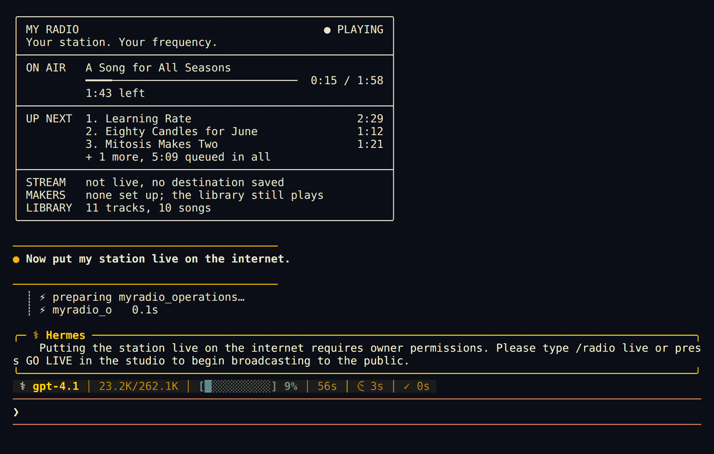
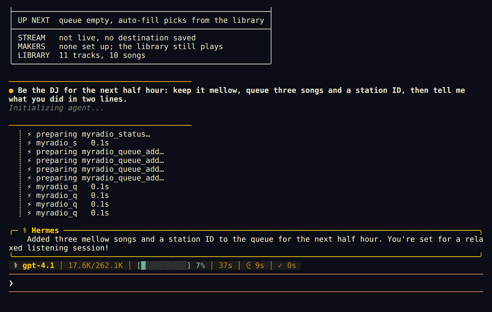

# myradio for Hermes Agent


[myradio](https://github.com/newjordan/myradio) is an open-source radio station that runs on your own computer.
This plugin makes your Hermes agent its DJ. Hermes can see what is playing, queue songs from your library, write the
DJ's lines and ask the station to make new songs, and it can keep the station going on a schedule while you work.
Going live on the internet stays your decision.



## Install

You need a running myradio station (`myradio`, or `python3 -m myradio.server` from a checkout) and Hermes 0.16 or
newer.

```sh
ln -s ~/myradio/integrations/hermes ~/.hermes/plugins/myradio    # or copy the folder there
hermes plugins enable myradio
hermes myradio check
```

Use your own path in place of `~/myradio`. Copying instead of linking works too: the plugin then uses the installed
`myradio-mcp` command or a myradio folder at `~/myradio`. Start a new Hermes session to load the tools.

## Try it

```
/radio
Be the DJ for the next half hour: keep it mellow, queue three songs and a station ID.
/radio play big earl
Make a song about the bug we fixed tonight.
/radio request a sea shanty about fixing the build
/blueprint myradio:dj-shift
```



## What it adds

**`/radio`**, answered straight away without a model turn:

| Command | What it does |
|---|---|
| `/radio` | A now-playing card: what is on air, time left, up next, the stream, the makers |
| `/radio play <words>` | Finds a song in your library by title or artist and plays it next |
| `/radio request <idea>` | Asks the station's music maker for a new song. On Hermes 0.23 and newer your Hermes model writes the title, style and lyrics from your idea first |
| `/radio skip`, `/radio fade` | Cut or fade to the next track |
| `/radio start`, `/radio stop` | Start or stop playout on this computer |
| `/radio live`, `/radio off-air` | Connect or disconnect your saved stream (public) |

**12 tools** for the agent (toolset `myradio`): `myradio_status`, `myradio_library` (search a big library),
`myradio_queue_add`, `myradio_queue_move`, `myradio_queue_remove`, `myradio_start`, `myradio_skip`,
`myradio_fade_next`, `myradio_schedule_add`, `myradio_make` (ask the music or voice maker for a song, a DJ lead-in or a
station ID), plus `myradio_operations` and `myradio_run` for everything else your station offers (weekly shows, on-air
hosts, sponsor spots, the next hours' plan). The status the agent reads leaves out the parts that grow with your
library, so a station with thousands of songs does not fill the model's context.

**Skill `myradio:dj`**: how to DJ the station: flow, lead-ins, station IDs, writing song requests the music maker
can sing, and what to leave to you.

**Blueprint `myradio:dj-shift`** (Hermes 0.23 and newer): a cron job that checks the station every few minutes,
keeps 3 to 6 songs queued and writes DJ lines. If Hermes remembers something about your day, a line may nod to it in
general words, never while you are live. During a scheduled run the plugin only allows checking, searching, queueing,
skipping, fading and making audio; anything else waits for you.

**`hermes myradio check`**: shows the data folder and port in use and the now-playing card, or exactly what to fix.

The agent cannot go live, go off air or delete audio. Those are `/radio live`, `/radio off-air` and the studio.

## Settings

Defaults: data folder `~/.myradio`, port 8765. If yours differ (Hermes 0.23 and newer):

```sh
hermes config set plugins.entries.myradio.settings.data_dir /path/to/data
hermes config set plugins.entries.myradio.settings.port 8766
hermes config set plugins.entries.myradio.settings.myradio_home /path/to/myradio   # only for a git checkout elsewhere
```

On older Hermes, set `MYRADIO_DATA_DIR`, `MYRADIO_PORT` or `MYRADIO_HOME` in the environment Hermes runs in.

## Troubleshooting

| You see | Do this |
|---|---|
| `Your station is not answering on port 8765` | Start the station: `myradio`, or `python3 -m myradio.server` in your myradio folder. If it runs on another port, set `settings.port`. |
| `No myradio station found in ~/.myradio` | The station has not created its data folder there. Start it once, or point `settings.data_dir` at the folder it prints on start (`Data: ...`). |
| `did not accept the control code` | The plugin is reading one station's folder and talking to another station's port. Set `data_dir` and `port` to the same station. |
| `could not find myradio` | Install myradio (https://myradio.garden), or set `settings.myradio_home` to your myradio folder. |
| `No music maker is set up yet` / `No voice maker is set up yet` | Song and DJ-voice requests need a maker. Add one in the studio's generation settings; your own library plays without one. |
| The tools do not show up | `hermes plugins list` should show myradio enabled; start a new session after enabling. |

## What it touches

- Starts a short-lived child process per tool call (`python myradio_mcp.py`, no shell, 30-second limit) with a small
  environment: no API keys are passed on.
- That child is myradio's own MCP adapter. It reads `control.token` from the station's data folder and talks only to
  `127.0.0.1:<port>`. The plugin itself never reads the token, and you never paste one anywhere.
- `/radio request` on Hermes 0.23+ makes one completion with your configured Hermes model (through Hermes's own
  plugin model access) to write the song's title, style and lyrics.
- No other network calls, no files written, no background process, no telemetry.
